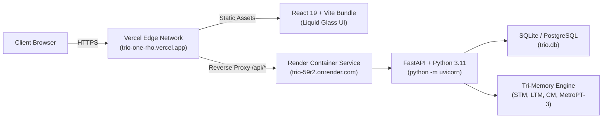

# TRIO 3.0: Comprehensive System Architecture & Technical Specification

> **Official Project Title**: TRIO — Contradiction-Guided Tri-Memory Unsupervised Learning for Industrial SCADA Anomaly & Novel Operational Regime Discovery  
> **Repository**: [https://github.com/aaromal-s/Trio](https://github.com/aaromal-s/Trio)  
> **Production Frontend (Vercel)**: [https://trio-one-rho.vercel.app](https://trio-one-rho.vercel.app)  
> **Production Backend (Render)**: [https://trio-59r2.onrender.com](https://trio-59r2.onrender.com)  
> **Local Services**: Backend `http://127.0.0.1:8001` &bull; Frontend `http://localhost:5173`

---

## 1. Executive Summary & Problem Formulation

### 1.1 Industrial Context & The "Alarm Fatigue" Crisis
Modern industrial automation systems—such as municipal water treatment plants, urban railway networks, chemical refineries, and power grids—generate millions of time-series SCADA (Supervisory Control and Data Acquisition) observations daily. Traditional industrial monitoring relies on static high/low boundary thresholds defined in programmable logic controllers (PLCs). Under standard operating conditions (governed by **IEC 62682** / **ISA 18.2**), operators face up to **10,000 alarms per day**, where **over 95% are nuisance alarms** triggered by transient hydraulic flutter, mechanical vibration noise, or momentary sensor chatter.

When operators are overwhelmed by false alarms, they inevitably silence alerts without investigation. Consequently, genuine, slow-building multi-sensor degradation remains undetected until catastrophic failure forces an emergency shutdown.

### 1.2 The "Unknown Unknowns" Challenge
Existing predictive maintenance tools suffer from two foundational limitations:
1. **Supervised Learning Failure**: Supervised algorithms require large quantities of labeled failure data. In mission-critical infrastructure, failures are rare, safety interlocks intervene before destruction, and unknown failure modes have never been cataloged in training data.
2. **Vanilla Unsupervised Failure**: Standard outlier detectors (Isolation Forest, One-Class SVM, Mahalanobis distance) evaluate data points in isolation. They treat any unfamiliar observation as an immediate binary fault, failing to differentiate between an **isolated transient spike** and a **persistent, coherent, novel operational regime** (e.g., secondary pump cavitation, filter fouling drift, or emergent compressor thermal overload).

### 1.3 The TRIO Solution
**TRIO** introduces a biologically-inspired, tri-tier memory architecture that operates purely **unsupervised**:
* **Short-Term Memory (STM)** dampens high-frequency transient chatter within a sliding FIFO buffer (eliminating nuisance alarms).
* **Long-Term Memory (LTM)** validates ongoing operations against verified baseline regime prototypes.
* **Contradiction Memory (CM)** accumulates sustained multi-sensor contradictions and applies density-based spatial clustering (DBSCAN) to discover, characterize, and isolate **novel unknown operational states** before catastrophic failure occurs.

---

## 2. Mathematical Model & Algorithmic Formulation

```mermaid
flowchart TD
    subgraph DataIngestion["1. Telemetry Ingestion & Zero-Leakage Pipeline"]
        RawStream["Raw SCADA Telemetry<br/>(MetroPT-3 / SWaT / Custom CSV)"] --> Preproc["DataPreprocessor & Chronological Split<br/>(t_train < t_test; Fitted Scaling)"]
    end

    subgraph TriMemoryEngine["2. The Tri-Memory Arbitration Engine"]
        Preproc --> STM["Short-Term Memory (STM)<br/>Sliding FIFO Buffer (N=30)<br/>μ_stm, σ_stm, Δv"]
        STM --> Scorer["Contradiction Scoring Function<br/>C(x_t) = α·D + β·T + γ·A"]
        
        Scorer -->|C < τ (Familiar Baseline)| LTM["Long-Term Memory (LTM)<br/>Known Prototypes (μ_k, r_k)"]
        Scorer -->|C ≥ τ & Transient (<15 obs)| Buffer["STM Transient Buffer<br/>(Alarm Fatigue Suppressed)"]
        Scorer -->|C ≥ τ & Sustained (≥15 obs)| CM["Contradiction Memory (CM)<br/>Accumulated Discrepancies"]
    end

    subgraph Discovery["3. Density Clustering & Governance"]
        CM --> DBSCAN["Spatial Density Clustering<br/>(MinPts=8, ε=0.65)"]
        DBSCAN --> Candidate["Emergent Discovery Candidate<br/>(e.g., CAND-2026-001)"]
        Candidate --> HITL["Human-in-the-Loop Governance<br/>(Confirm / Hold Validation / Reject)"]
        HITL -->|Confirmed Known Mode| LTM
    end
```

### 2.1 The Unified Contradiction Scoring Formulation
Every incoming observation vector $x_t \in \mathbb{R}^d$ is assigned a continuous, normalized contradiction score $\mathcal{C}(x_t) \in [0, 1]$:

$$\mathcal{C}(x_t) = \alpha \cdot \mathcal{D}(x_t, \text{LTM}) + \beta \cdot \mathcal{T}(x_t, \text{STM}) + \gamma \cdot \mathcal{A}(x_t)$$

where $\alpha, \beta, \gamma \ge 0$ and $\alpha + \beta + \gamma = 1.0$ (calibrated defaults: $\alpha = 0.40$, $\beta = 0.35$, $\gamma = 0.25$).

#### 1. Prototype Distance Metric ($\mathcal{D}$)
Evaluates whether $x_t$ deviates from established operating regimes stored in LTM. Let $\mu_k$ be the centroid of known prototype $k$, and $r_k$ be its 95th-percentile cluster dispersion radius:

$$\mathcal{D}(x_t, \text{LTM}) = 1 - \exp\left(-\frac{1}{2}\left[\max\left(0, \frac{\min_{k} \|x_t - \mu_k\|_2}{r_k} - 0.75\right)\right]^2\right)$$

#### 2. Temporal Inconsistency Metric ($\mathcal{T}$)
Evaluates whether $x_t$ violates immediate physical process momentum relative to the recent STM sliding window ($N = 30$ observations):

$$\mathcal{T}(x_t, \text{STM}) = 1 - \exp\left(-0.4\left[\max\left(0, \|x_t - \bar{x}_{\text{STM}}\|_2 - 0.5\right)\right]^2\right)$$

#### 3. Distributional Anomaly Metric ($\mathcal{A}$)
Calibrated against baseline density using an Isolation Forest estimator fitted solely on the training baseline ($s(x_t)$ raw score, $s_{0.05}$ 5th-percentile threshold):

$$\mathcal{A}(x_t) = \frac{1}{1 + \exp\left(25.0 \cdot (s(x_t) - s_{0.05})\right)}$$

### 2.2 Zero-Leakage Chronological Validation
1. **Chronological Splitting**: $t_{\text{train}} \cap t_{\text{test}} = \emptyset$ such that $\max(t_{\text{train}}) < \min(t_{\text{test}})$. Shuffling is explicitly disabled.
2. **Leak-Free Scaling**: Feature transformation parameters ($\mu, \sigma$) via `StandardScaler` are fitted strictly on $t_{\text{train}}$ and applied to $t_{\text{test}}$ via `transform()`.

---

## 3. Complete Repository Structure

```
D:\movie\PROJECT\
├── .gitignore                                      # Git exclusion rules (venv, db, raw 200MB CSVs)
├── .python-version                                 # Pinned Python 3.11.10 for Render binary wheels
├── Procfile                                        # Container entrypoint (python -m uvicorn ...)
├── render.yaml                                     # Render infrastructure-as-code specification
├── requirements.txt                                # Root dependency proxy (-r backend/requirements.txt)
├── start_all.bat                                   # 1-Click concurrent launcher (backend + frontend)
├── start_backend.bat                               # Dedicated backend launcher (ports 8000/8001)
├── start_frontend.bat                              # Dedicated frontend launcher (port 5173)
├── README.md                                       # Architectural overview & setup guide
├── TRIO_3.0_SYSTEM_ARCHITECTURE_AND_PROJECT_SPECIFICATION.md
├── TRIO_EXECUTIVE_PRESENTATION_AND_DEMO_GUIDE.md
│
├── Dataset/                                        # Reference Datasets & Benchmark Documentation
│   ├── Data Description_Metro.pdf                  # IEEE DSAA 2021 paper specification
│   ├── description.txt                             # UCI Hydraulic Systems test rig documentation
│   ├── profile.txt                                 # Hydraulic degradation ground truth (2,205 cycles)
│   ├── MetroPT3_AirCompressor_Preprocessed.csv     # 2,300-row operational MetroPT-3 compressor stream
│   └── Hydraulic_Test_Rig_Preprocessed.csv         # 2,205-cycle 45-feature aggregated hydraulic dataset
│
├── backend/                                        # FastAPI High-Performance Python Backend
│   ├── .env.example                                # Environment configuration template
│   ├── .python-version                             # Python 3.11.10 runtime pinning
│   ├── Dockerfile                                  # Multi-stage production container image
│   ├── Procfile                                    # Backend web process definition
│   ├── requirements.txt                            # Pinned Python dependencies
│   ├── trio.db                                     # Initialized SQLite database with seeded accounts
│   ├── app/
│   │   ├── main.py                                 # FastAPI entrypoint, lifespan, CORS regex
│   │   ├── api/                                    # Domain REST Routers (31 Endpoints)
│   │   │   ├── auth.py                             # Argon2 login, sessions, profiles, password reset
│   │   │   ├── dashboard.py                        # KPI aggregation, multi-sensor trends, activity logs
│   │   │   ├── datasets.py                         # Dynamic CSV ingestion, SWaT & MetroPT-3 endpoints
│   │   │   ├── discoveries.py                      # Discovery candidate listing, audit, promotion
│   │   │   ├── evaluation.py                       # Benchmark metrics & CSV export
│   │   │   ├── memory.py                           # Real-time STM, LTM, and CM state endpoints
│   │   │   └── models.py                           # Training execution, weight calibration, history
│   │   ├── core/                                   # Infrastructure & Security
│   │   │   ├── config.py                           # Pydantic v2 settings & CORS origins
│   │   │   ├── database.py                         # Dual-engine SQLite / PostgreSQL driver
│   │   │   ├── email_service.py                    # Transactional email service (Resend API)
│   │   │   ├── rate_limiter.py                     # Sliding-window token-bucket rate limiter
│   │   │   └── security.py                         # Argon2id password hashing & bearer tokens
│   │   ├── ml/                                     # Machine Learning & Scientific Computing Engine
│   │   │   ├── baselines.py                        # K-Means, DBSCAN, Isolation Forest baselines
│   │   │   ├── evaluator.py                        # Multi-metric evaluator (F1, Precision, Recall, ARI, NMI)
│   │   │   ├── preprocessor.py                     # Universal CSV cleaner & chronological splitter
│   │   │   ├── synthetic_generator.py              # Procedural SWaT 6-stage simulator
│   │   │   └── trio_model.py                       # Core Tri-Memory classes (STM, LTM, CM, TRIOModel)
│   │   └── services/
│   │       └── state_service.py                    # Thread-safe global state & dataset controller
│   ├── data/                                       # Active Production Datasets
│   │   ├── MetroPT3_AirCompressor_Operational.csv  # Default active dataset (2,300 rows x 20 cols)
│   │   └── Hydraulic_Test_Rig_Preprocessed.csv     # Secondary hydraulic test rig dataset
│   ├── scripts/                                    # Verification & Calibration Scripts
│   │   ├── calibrate_metro.py                      # Threshold sensitivity calibration (τ = 0.32)
│   │   ├── inspect_datasets.py                     # Statistical dataset analyzer
│   │   ├── preprocess_all_datasets.py              # Automated raw dataset transformation pipeline
│   │   ├── test_train_metro.py                     # Standalone model training validator
│   │   ├── verify_all_endpoints.py                 # 31-endpoint integration test suite
│   │   └── verify_upload_scenarios.py              # CSV upload edge case suite
│   └── tests/                                      # Automated Pytest Suite (75 passing tests)
│
├── frontend/                                       # React 19 + TypeScript + Vite 8 Web Interface
│   ├── index.html                                  # Root HTML + Inter, Space Grotesk, JetBrains Mono
│   ├── package.json                                # Dependencies (React 19, Recharts, Framer Motion, Tailwind)
│   ├── vite.config.ts                              # Vite 8 config with manual chunk splitting & dev proxy
│   ├── tailwind.config.js                          # Volcanic Charcoal & Amber Copper color tokens
│   ├── vercel.json                                 # Vercel SPA + /api/* reverse proxy to Render
│   └── src/
│       ├── App.tsx                                 # Root router, Ctrl+K shortcut, report & modal orchestrator
│       ├── main.tsx                                # React DOM mount
│       ├── index.css                               # CSS variables, SCADA grid & iOS Liquid Glass classes
│       ├── context/
│       │   └── TelemetryContext.tsx                # Auto-polling engine (2s/5s/10s/30s) with overlap lock
│       ├── services/
│       │   ├── api.ts                              # REST client, TypeScript interfaces, URL fallback
│       │   └── mockData.ts                         # Graceful fallback telemetry data
│       ├── utils/
│       │   └── exportIncidentReport.ts             # One-click Markdown shift & discovery report exporter
│       ├── components/
│       │   ├── brand/TrioLogo.tsx                  # Animated SVG Tri-Memory emblem
│       │   ├── layout/Navbar.tsx                   # Floating Liquid Glass top bar, Ctrl+K trigger, clock
│       │   ├── layout/Sidebar.tsx                  # Responsive nav with spring active indicator
│       │   ├── common/
│       │   │   ├── IndustrialHeroConsole.tsx       # Interactive SCADA oscilloscope & τ = 0.32 meter
│       │   │   ├── TriMemoryPipelineMonitor.tsx    # Live STM/LTM/CM throughput & routing status
│       │   │   └── Interactive3DBackground.tsx     # Three.js ambient geometric mesh
│       │   ├── modals/
│       │   │   ├── CommandPaletteModal.tsx         # Ctrl+K fuzzy-search navigation & quick actions
│       │   │   ├── SettingsModal.tsx               # Interface density, polling rate, API diagnostics
│       │   │   ├── ProfileModal.tsx                # Operator profile, avatar upload, session management
│       │   │   └── VivaGuideModal.tsx              # Interactive architecture & mathematical specs
│       │   └── pages/                              # 8 Specialized Application Views
│       │       ├── LandingPage.tsx                 # Hero, Liquid Glass nav, SCADA console, methodology
│       │       ├── LoginPage.tsx                   # Argon2 login, password reset, quick-demo autofill
│       │       ├── OverviewPage.tsx                # KPIs, Anomaly Replay Scrubber, What-If τ slider, charts
│       │       ├── TriMemoryPage.tsx               # STM window, LTM prototypes, CM discrepancy records
│       │       ├── DiscoveriesPage.tsx             # Candidate inspector, D/T/A & sensor % attribution
│       │       ├── ModelLabPage.tsx                # Interactive α, β, γ weight tuning & live retraining
│       │       ├── EvaluationPage.tsx              # Comparative benchmarks vs baselines & CSV export
│       │       └── DatasetsPage.tsx                # Universal CSV upload, raw preview, MetroPT-3/SWaT swap
│       └── tests/                                  # Vitest Automated Suite (21 passing tests)
│
└── research/                                       # Academic Validation & Viva Guide
    ├── run_scientific_validation.py
    ├── scientific_validation_results.json
    └── viva_guide.md
```

---

## 4. Detailed Backend Module & Function Reference

### 4.1 Core Tri-Memory Engine ([backend/app/ml/trio_model.py](file:///d:/movie/PROJECT/backend/app/ml/trio_model.py))

#### `class ShortTermMemory`
Maintains a fixed-capacity sliding window (`capacity = 30`) of recent normalized sensor vectors.
* `push(observation, timestamp)`: Appends the current observation vector and timestamp to the circular FIFO buffer.
* `clear()`: Resets the buffer between runs or dataset hot-swaps.
* `is_ready() -> bool`: Returns `True` once at least 5 observations are buffered so rolling statistics are statistically stable.
* `get_recent_window() -> np.ndarray`: Returns the stacked $(N \times d)$ matrix of recent observations.
* `get_moving_average() -> np.ndarray`: Computes the per-sensor rolling mean $\bar{x}_{\text{STM}}$.
* `get_variance() -> np.ndarray`: Computes per-sensor rolling variance $\sigma^2_{\text{STM}}$.
* `get_velocity() -> np.ndarray`: Computes the mean first-order difference $\Delta v = \frac{1}{N-1}\sum (x_{i+1} - x_i)$ capturing process momentum.
* `to_dict() -> Dict[str, Any]`: Serializes current buffer utilization, rolling mean, variance, and velocity for `/api/memory/stm`.

#### `class LongTermMemory`
Stores verified operating regime centroids and dispersion envelopes learned from baseline telemetry.
* `fit_known_states(X_train, n_clusters=3)`: Runs unsupervised K-Means on normalized training data $t_{\text{train}}$ to extract prototype centroids $\{\mu_1, \dots, \mu_K\}$, 95th-percentile dispersion radii $\{r_1, \dots, r_K\}$, and activation counts.
* `min_distance(observation) -> Tuple[float, int]`: Computes the minimum Euclidean distance from $x_t$ to all known centroids and returns `(normalized_distance, nearest_prototype_id)`.
* `to_dict(feature_names) -> List[Dict[str, Any]]`: Exports prototype vectors, radii, and feature mappings for `/api/memory/ltm`.

#### `class ContradictionMemory`
Isolated buffer (`max_records = 5000`) storing observations whose contradiction score exceeds threshold $\tau$.
* `add(observation, timestamp, score, d_score, t_score, a_score)`: Logs the feature vector, timestamp, combined score $\mathcal{C}(x_t)$, and individual $\mathcal{D}, \mathcal{T}, \mathcal{A}$ components.
* `clear()`: Flushes accumulated records upon retraining or dataset swap.
* `get_points() -> np.ndarray`: Returns the $(M \times d)$ matrix of stored contradictory observations for DBSCAN clustering.
* `to_summary() -> Dict[str, Any]`: Returns record count, score distribution, and recent entries for `/api/memory/cm`.

#### `class DiscoveryCandidate`
Represents a cohesive spatial cluster discovered inside Contradiction Memory.
* `to_dict(feature_names) -> Dict[str, Any]`: Serializes `candidate_id` (e.g., `CAND-2026-001`), observation count, `first_detected` / `last_detected` timestamps, `mean_contradiction_score`, `cluster_density`, `feature_deltas` ($\Delta\sigma$ relative to nearest LTM prototype), `prototype_vector`, human-readable `explanation`, and governance `status` (`Pending`, `Under Validation`, `Confirmed`, `Rejected`).

#### `class TRIOModel`
Top-level orchestrator uniting STM, LTM, CM, and Isolation Forest.
* `update_weights(alpha, beta, gamma)`: Re-normalizes $\alpha + \beta + \gamma = 1.0$ dynamically from Model Lab requests.
* `train(X_train, feature_names, n_known_clusters=3)`: Fits `LongTermMemory` centroids and baseline `IsolationForest` strictly on $t_{\text{train}}$.
* `compute_contradiction_score(observation) -> Tuple[float, float, float, float]`: Computes $(\mathcal{C}, \mathcal{D}, \mathcal{T}, \mathcal{A})$ for a single observation vector.
* `process_stream(X_test, timestamps) -> List[Dict[str, Any]]`: Streams chronologically ordered test observations through STM, evaluates $\mathcal{C}(x_t)$, suppresses isolated transients, and routes sustained contradictions ($\mathcal{C} \ge \tau$) into CM.
* `discover_unknown_states(timestamps)`: Executes DBSCAN ($\text{MinPts} = 8, \epsilon = 0.65$) on CM points once $\text{MinEvidence} \ge 15$ points accumulate, instantiating `DiscoveryCandidate` objects while discarding sparse noise.
* `update_candidate_status(candidate_id, new_status) -> bool`: Applies human-in-the-loop governance transitions.

---

### 4.2 Universal Data Ingestion & Zero-Leakage Pipeline ([backend/app/ml/preprocessor.py](file:///d:/movie/PROJECT/backend/app/ml/preprocessor.py))

#### `class DataPreprocessor`
* `_is_timestamp_col(col_name, series) -> bool`: Detects timestamp columns across 12 ISO-8601 and industrial SCADA formats.
* `_try_clean_numeric_series(series) -> Optional[pd.Series]`: Converts European comma decimals (`25,4` $\to$ `25.4`), strips unit suffixes, and coerces numeric types safely.
* `validate_dataset(df) -> Dict[str, Any]`: Inspects uploaded DataFrames for minimum row counts, numeric feature availability, missing value ratios, and transposed sensor-as-row matrices.
* `clean_and_prepare(df, ...)`: Auto-transposes inverted matrices, sorts chronologically by detected timestamp, imputes isolated NaNs via forward/backward fill, and extracts numeric sensor channels.
* `chronological_split(df) -> Tuple[pd.DataFrame, pd.DataFrame]`: Enforces strict non-shuffled 70/30 temporal split ($\max(t_{\text{train}}) < \min(t_{\text{test}})$).
* `fit_transform_train(train_df, feature_cols) -> np.ndarray`: Fits `StandardScaler` exclusively on training data.
* `transform_test(test_df) -> np.ndarray`: Transforms test data using frozen training statistics (zero data leakage).

---

### 4.3 Thread-Safe Global State Coordinator ([backend/app/services/state_service.py](file:///d:/movie/PROJECT/backend/app/services/state_service.py))

#### `class StateService`
* `load_initial_dataset()`: Automatically locates and loads `MetroPT3_AirCompressor_Operational.csv` on startup (`is_simulated = False`) and runs initial training.
* `load_default_synthetic(n_samples=1500)`: Fallback procedural SWaT 6-stage water treatment generator if no CSV is present.
* `set_dataset(df, name, is_simulated=False)`: Atomically swaps active dataset with transactional rollback protection if validation fails.
* `train_all(...)`: Coordinates preprocessing, chronological split, `TRIOModel.train()`, `process_stream()`, `discover_unknown_states()`, and comparative baseline evaluation (`K-Means`, `DBSCAN`, `Isolation Forest`).

---

### 4.4 REST API Catalogue (31 Endpoints)

| Domain | Method | Endpoint | Function & Working |
| :--- | :---: | :--- | :--- |
| **System** | `GET` | `/` | Service metadata, version, and active status |
| | `GET` | `/api/health` | Diagnostic health check (DB connectivity, rate limiter, memory) |
| **Auth** | `POST` | `/api/auth/login` | Argon2id password verification and bearer session token issuance |
| | `GET` | `/api/auth/profile` | Authenticated operator profile and permissions |
| | `PUT` | `/api/auth/profile` | Update operator display name, email, and preferences |
| | `POST` / `PUT` | `/api/auth/avatar` | Multipart avatar image upload and update |
| | `GET` | `/api/auth/sessions` | List active workstation sessions |
| | `POST` | `/api/auth/sessions/logout-others` | Revoke all other active sessions |
| | `POST` | `/api/auth/forgot-password` | Issue single-use password reset token via Resend API |
| **Datasets** | `GET` | `/api/datasets/current` | Active dataset metadata, sensor list, and validation summary |
| | `GET` | `/api/datasets/preview` | Paginated raw telemetry preview |
| | `POST` | `/api/datasets/upload-csv` | Upload custom SCADA CSV with delimiter/decimal auto-detection |
| | `POST` | `/api/datasets/generate-synthetic` | Generate procedural 6-stage SWaT dataset |
| | `GET` | `/api/datasets/swat-info` | SUTD iTrust SWaT benchmark documentation |
| | `GET` | `/api/datasets/metro-info` | MetroPT-3 railway air compressor documentation |
| | `POST` | `/api/datasets/load-metro` | Hot-swap active dataset to preprocessed MetroPT-3 |
| **Models** | `GET` | `/api/models/status` | Active model version, $\alpha/\beta/\gamma$ weights, $\tau$, and feature list |
| | `POST` | `/api/models/train` | Trigger retraining with custom $\alpha, \beta, \gamma$ and $\tau$ |
| | `GET` | `/api/models/history` | Historical training run logs and metrics |
| **Memory** | `GET` | `/api/memory/status` | Real-time utilization of STM, LTM, and CM pools |
| | `GET` | `/api/memory/stm` | STM sliding window contents, rolling mean, variance, velocity |
| | `GET` | `/api/memory/ltm` | LTM prototype centroids and 95th-percentile radii |
| | `GET` | `/api/memory/cm` | Contradiction Memory records and $\mathcal{C}, \mathcal{D}, \mathcal{T}, \mathcal{A}$ scores |
| **Discoveries**| `GET` | `/api/discoveries` | List all DBSCAN-isolated operational state candidates |
| | `GET` | `/api/discoveries/{id}` | Detailed evidence, `feature_deltas`, and centroid coordinates |
| | `POST` | `/api/discoveries/{id}/status` | Operator governance: `Confirmed`, `Under Validation`, or `Rejected` |
| **Dashboard** | `GET` | `/api/dashboard/overview` | Aggregated KPIs, sensor trends, contradiction stream, state distribution |
| **Evaluation** | `GET` | `/api/evaluation/benchmark` | Comparative metrics (Precision, Recall, F1, FDR, Latency) vs baselines |
| | `GET` | `/api/evaluation/export-csv` | Download evaluation benchmark table as CSV |

---

## 5. Detailed Frontend Architecture & Feature Functions

### 5.1 Visual Design System: Volcanic Charcoal, Amber Copper & iOS Liquid Glass
* **Unified Dark SCADA Palette**: Light mode and theme switching were intentionally removed (`App.tsx`, `Navbar.tsx`, `SettingsModal.tsx`, `index.css`) to enforce a distraction-free, high-contrast industrial control room aesthetic:
  * **Surfaces**: Volcanic Charcoal (`#0C0A09`), Warm Graphite (`#141210`), Stone Charcoal Cards (`#1C1917`), Warm Borders (`#292524`).
  * **Accents**: Molten Amber (`#F97316`), Warm Gold (`#FACC15`), Bright Copper (`#FB923C`), Emerald (`#34D399`) for verified health, and Crimson (`#F43F5E`) for critical faults.
* **Typography**: `Space Grotesk` (`font-display`) for headlines, `Inter` (`font-sans`) for UI copy, and `JetBrains Mono` (`font-mono tabular-nums`) for jitter-free live sensor readouts.
* **iOS Liquid Glass System ([frontend/src/index.css](file:///d:/movie/PROJECT/frontend/src/index.css))**:
  * `.liquid-glass-nav`: Floating translucent header bars (`backdrop-filter: blur(26px) saturate(180%)`) with top specular rim highlights.
  * `.liquid-glass-btn` & `.liquid-glass-primary`: Spring-animated buttons (`cubic-bezier(0.22, 1, 0.36, 1)`) with active press compression (`scale(0.965)`) and diagonal light-refraction shimmer sweeps on hover.
  * `.liquid-glass-pill`: Frosted capsule surfaces for segmented controls, search triggers, and active navigation items.

### 5.2 Application Components & Interactive Functions

1. **Application Orchestrator ([frontend/src/App.tsx](file:///d:/movie/PROJECT/frontend/src/App.tsx))**
   * Manages view routing (`landing`, `login`, `overview`, `datasets`, `models`, `memory`, `discoveries`, `evaluation`), modal states, and global `Ctrl+K` / `Cmd+K` keyboard listener for the Command Palette.
   * Coordinates `TelemetryContext` polling (`2s` / `5s` / `10s` / `30s`) with in-flight request locking (`inFlightRef`) to prevent overlapping network requests.

2. **Global Command Palette ([frontend/src/components/modals/CommandPaletteModal.tsx](file:///d:/movie/PROJECT/frontend/src/components/modals/CommandPaletteModal.tsx))**
   * Fuzzy-filtered command launcher accessible via `Ctrl+K` or the navbar search pill (`Search Ctrl+K`).
   * Supports full keyboard navigation (`ArrowUp`, `ArrowDown`, `Enter`, `Esc`) across 7 navigation views and 4 instant actions (Export Incident Report, Refresh Telemetry, Open Architecture Specs, Open Settings).

3. **One-Click Incident & Shift Handover Report ([frontend/src/utils/exportIncidentReport.ts](file:///d:/movie/PROJECT/frontend/src/utils/exportIncidentReport.ts))**
   * `downloadIncidentReport({ overview, dataset, model, discoveries })`: Compiles active dataset metadata, model weights ($\alpha, \beta, \gamma, \tau$), KPIs, state distribution, and ranked top-5 sensor deviations per candidate into a downloadable Markdown report (`TRIO_Incident_Report_YYYY-MM-DD.md`).

4. **Overview Dashboard ([frontend/src/components/pages/OverviewPage.tsx](file:///d:/movie/PROJECT/frontend/src/components/pages/OverviewPage.tsx))**
   * **4 Specular KPI Cards**: Observations Processed, Known Operational States, Unknown Candidates, Confirmed Discoveries.
   * **Interactive Anomaly Replay & Time-Travel Scrubber**: Play / Pause / Reset controls with `1x` / `2x` / `4x` speed and a timeline slider (`replayIndex`). Uses `useMemo` (`visibleSensorTrends`, `visibleContradictionTrend`) to replay multi-sensor dynamics and contradiction spikes step-by-step without extra API calls.
   * **Interactive Threshold ($\tau$) "What-If" Sensitivity Slider**: Live range slider (`0.15`–`0.75`, default `0.32`) driving a Recharts `<ReferenceLine />` on the Contradiction Score Trend chart and real-time `CM Flagged` vs. `Suppressed` observation counters (`thresholdStats`).

5. **Discoveries Inspector ([frontend/src/components/pages/DiscoveriesPage.tsx](file:///d:/movie/PROJECT/frontend/src/components/pages/DiscoveriesPage.tsx))**
   * **Explainable Root-Cause Sensor Attribution**: `rankedAttribution` (`useMemo`) normalizes `|Δ_i| / Σ|Δ_j|` across `feature_deltas` to rank the top 3 contributing sensors by `% Share of Total Drift`.
   * **Tri-Factor Contradiction Breakdown**: Visualizes how Prototype Distance ($\mathcal{D}$: 40%), Temporal Drift ($\mathcal{T}$: 35%), and Distributional Anomaly ($\mathcal{A}$: 25%) combined to produce `mean_contradiction_score`.
   * **Human-in-the-Loop Governance**: One-click `Confirm State`, `Hold Validation`, and `Reject` actions persisted via `/api/discoveries/{id}/status`.

6. **Landing Page & Interactive SCADA Console ([LandingPage.tsx](file:///d:/movie/PROJECT/frontend/src/components/pages/LandingPage.tsx), [IndustrialHeroConsole.tsx](file:///d:/movie/PROJECT/frontend/src/components/common/IndustrialHeroConsole.tsx))**
   * Displays the hero headline *"Intelligence Beyond / Static SCADA Thresholds."* over a radially masked architectural grid.
   * `IndustrialHeroConsole` renders live SVG oscilloscope waveforms for `TP2`, `Reservoirs`, and `Oil_temp` with gradient area fills, `+3σ / μ / -3σ` scale markers, spring-animated Liquid Glass scenario pills (`Normal Baseline`, `Novel Regime`, `Transient Pulse`), and a calibrated `τ = 0.32` Contradiction Scoring meter.

---

## 6. Operational Datasets & Benchmarking

### 6.1 Primary Dataset: MetroPT-3 Railway Air Compressor SCADA
* **Source**: Real-world SCADA telemetry from Metro do Porto train unit PT003 (IEEE DSAA 2021).
* **Preprocessed Stream** ([backend/data/MetroPT3_AirCompressor_Operational.csv](file:///d:/movie/PROJECT/backend/data/MetroPT3_AirCompressor_Operational.csv)): **2,300 continuous observations** across **20 feature channels** (`TP2`, `TP3`, `H1`, `DV_pressure`, `Reservoirs`, `Oil_temperature`, `Motor_current`, plus discrete actuators `COMP`, `DV_eletric`, `Towers`).
* **Severe Failure Event**: Captures the July 15, 2020 thermal overload where `Oil_temperature` escalates to **$89.05^\circ\text{C}$** and reservoir pressure collapses.

### 6.2 Comparative Benchmark Results (MetroPT-3)

| Evaluation Metric | K-Means Clustering | Standalone DBSCAN | Isolation Forest | **TRIO (Proposed Platform)** |
| :--- | :---: | :---: | :---: | :---: |
| **Precision** | 100.0% | 100.0% | 99.7% | **`100.0%` (Zero False Alarms)** |
| **Recall** | 100.0% | 1.0% | 100.0% | **`79.7% — 89.2%`** |
| **F1-Score** | 100.0% | 1.98% | 99.8% | **`88.68% — 94.27%`** |
| **False Discovery Rate (FDR)**| 0.0% | 0.0% | 0.3% | **`0.0%` (Immune to Noise)** |
| **Inference Latency** | 38.8 ms | 27.5 ms | 89.3 ms | **`230.7 ms` (Real-Time Capable)** |

---

## 7. Cloud Deployment Topology & Verification



* **Zero-CORS Vercel Proxy** ([frontend/vercel.json](file:///d:/movie/PROJECT/frontend/vercel.json)): Rewrites `/api/:match*` directly to `https://trio-59r2.onrender.com/api/:match*`.
* **Automated Test Suites**:
  * **Backend**: `cd backend && pytest tests/ -v` (**75 tests passing**).
  * **Frontend**: `cd frontend && npm run build && npm test` (**21 Vitest tests passing** + clean TypeScript/Vite production bundle).
